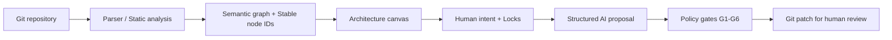

# CircuitCode — Visual Intent IDE สำหรับสถาปัตยกรรมซอฟต์แวร์

> **ออกแบบโค้ดให้มองเห็นเหมือนแผงวงจร กำหนดเจตนาให้ชัด และควบคุมการแก้โค้ดด้วย AI ผ่านกฎที่ตรวจสอบได้**
>
> **สถานะโครงการ: Architecture / Design Specification (ยังไม่ใช่แอปพร้อมใช้งาน)** ขณะนี้ Repository มีเอกสารออกแบบเป็นหลัก ยังไม่มี CLI, Web UI หรือแพ็กเกจสำหรับติดตั้งตามสถาปัตยกรรมที่เสนอ

[อ่าน Architecture Specification ฉบับเต็ม](docs/ARCHITECTURE.md) · [เสนอประเด็นหรือร่วมออกแบบ](https://github.com/ihacked07/CircuitCode/issues) · [MIT License](LICENSE)

## CircuitCode คืออะไร?

**CircuitCode** เป็นแนวคิด **Visual Intent IDE** สำหรับอ่านโครงสร้างซอฟต์แวร์จาก Git Repository แล้วแสดงเป็นสถาปัตยกรรมแบบแผงวงจรอิเล็กทรอนิกส์ (Software EDA)

แทนที่จะวาดไดอะแกรมขึ้นเองแบบอิสระ ระบบที่วางแผนไว้จะอ้างอิง **ไฟล์, โมดูล, ฟังก์ชัน, ชนิดข้อมูล และความสัมพันธ์จริงใน Source Code** พร้อมชั้นข้อมูลสำหรับให้มนุษย์ระบุสิ่งที่ต้องการเปลี่ยน และสิ่งที่ห้าม AI แก้ไข

**หลักสำคัญ:** Git Repository ยังคงเป็น **Source of Truth** เสมอ ส่วน CircuitCode เป็นชั้นวิเคราะห์และจัดการเจตนาที่ผูกกับโค้ด ไม่ใช่ระบบมาแทน Git

## ภาพรวมแนวคิด



*แผนภาพนี้แสดงสถาปัตยกรรมเป้าหมาย ไม่ใช่หลักฐานว่าฟีเจอร์ทั้งหมดทำงานแล้ว*

### ต่างจาก Flowchart / Low-code / AI coding assistant อย่างไร?

| เครื่องมือทั่วไป | แนวทางของ CircuitCode (ตามสเปก) |
| --- | --- |
| ไดอะแกรมที่วาดเอง | โหนดและเส้นเชื่อมมีที่มาจาก Symbol/Relationship ในโค้ด |
| โมเดล AI แก้ไฟล์โดยตรง | AI เสนอ `EditProposal` เท่านั้น ระบบ Go ตรวจเงื่อนไขและสร้าง Patch |
| แก้ชื่อหรือย้ายไฟล์แล้ว Diagram หลุด | ใช้ Stable `nodeId` แยกจาก `anchor` ที่คำนวณใหม่ |
| บอก AI ว่า “ห้ามแก้ไฟล์นี้” ด้วย Prompt | ใช้ Lock Policy และ Gate ในโปรแกรม ไม่พึ่ง Prompt อย่างเดียว |
| UI เป็นข้อมูลหลัก | Git คือ Source of Truth; Semantic Overlay แยกข้อมูลมนุษย์ออกจากข้อมูลที่สร้างใหม่ได้ |

## คุณสมบัติที่ออกแบบไว้ (Planned)

### 1. มองโค้ดเป็นวงจรแบบหลายระดับ (L0–L6)

| ชั้น | มองเห็นอะไร |
| --- | --- |
| **L0** | ระบบ / Repository |
| **L1** | Services และหน่วยที่ Deploy ได้ |
| **L2** | Modules / Packages |
| **L3** | Components / Types |
| **L4** | Functions |
| **L5** | Control Flow ภายในฟังก์ชัน |
| **L6** | Data Flow และการส่งต่อค่าระหว่างคำสั่ง |

แนวคิดคือคลิกเข้าไปดู “ภายในชิป” ทีละชั้น ไม่ต้องเปิดกราฟทั้งหมดพร้อมกัน โดย L5–L6 จะวิเคราะห์แบบ Lazy เพื่อควบคุมทรัพยากร

### 2. Stable Identity — หัวใจของโครงการ

ทุกโหนดจะมีตัวระบุสองชุดตามสเปก:

- `nodeId`: UUIDv7 สำหรับอ้างอิงระยะยาวใน Overlay
- `anchor`: ตำแหน่ง/คุณลักษณะของ Symbol ที่สร้างใหม่ได้จาก AST

ระบบ **Reconciler** ต้องพยายามผูกโหนดเดิมให้ถูกต้องแม้ `gofmt`, Rename หรือ Move File และต้อง **ส่งให้มนุษย์ตัดสินใจเมื่อไม่มั่นใจ** แทนการเดาหรือทำ Lock หาย

### 3. Semantic Overlay — แยกสิ่งที่โปรแกรมคำนวณได้กับสิ่งที่มนุษย์กำหนด

ตามสเปก โฟลเดอร์ `.circuitcode/` ของโปรเจกต์เป้าหมายจะมีไฟล์หลัก 6 ไฟล์:

| ไฟล์ | หน้าที่ | แนวทางดูแล |
| --- | --- | --- |
| `graph.json` | โหนดและเส้นเชื่อมจากโค้ด | สร้างใหม่ได้ |
| `contracts.json` | สัญญาที่อ่านได้จากโค้ด | สร้างใหม่ได้ |
| `intent.json` | ความต้องการ คำอธิบาย และ Semantic Overrides | **ต้องเก็บรักษา** |
| `locks.json` | การล็อกและนโยบายแก้ไข | **ต้องเก็บรักษา** |
| `layout.json` | ตำแหน่งการจัดวางใน Canvas | สร้างใหม่ได้ |
| `metadata.json` | เวอร์ชัน Schema, Hash และ Namespace | เมทาดาทาระบบ |

การลบหรือสร้างไฟล์ Generated ใหม่ **ต้องไม่ทำให้ Intent/Locks ที่มนุษย์บันทึกไว้สูญหาย** นี่เป็นข้อกำหนดเชิงสถาปัตยกรรม ไม่ใช่ความสามารถที่ทดสอบสำเร็จแล้วใน Repository ปัจจุบัน

### 4. AI Bridge ที่บังคับตรวจความปลอดภัยก่อนแก้โค้ด

แนวคิดหลักคือ AI **ไม่รับสิทธิ์เขียนไฟล์หรือสั่ง Git ตรง** แต่คืนข้อเสนอแก้ไขแบบมีโครงสร้างให้ระบบควบคุมตรวจสอบตามขั้นตอน:

| Gate | สิ่งที่ตรวจ |
| --- | --- |
| **G1** | ใช้ Patch ได้หรือไม่ |
| **G2** | กระทบโหนดที่ Lock / Security Critical หรือไม่ |
| **G3** | Contract / Signature เปลี่ยนอย่างไร |
| **G4** | เกิด Hidden Dependency ใหม่หรือไม่ |
| **G5** | เปลี่ยนเฉพาะ Layer / Subtree ที่ได้รับอนุญาตหรือไม่ |
| **G6** | Build และ Test ผ่านหรือไม่ |

เมื่อทุก Gate ผ่านจึงค่อยสร้าง Patch ให้ **มนุษย์ตรวจและอนุมัติ** โดยใช้พื้นที่ทำงาน Git แยกต่างหาก แนวทางนี้อยู่ในเอกสารสเปกและ **ยังไม่ควรถือเป็น Security Guarantee จนกว่าจะมี Implementation + Test Evidence**

## เทคโนโลยีที่วางแผนใช้

| ส่วน | แนวทาง |
| --- | --- |
| Core / Analyzer / Policy | **Go** (`go/packages`, `go/types`, SSA, CHA) |
| Semantic Store | **JSON files** พร้อม Schema Versioning |
| CLI | **Cobra** (ออกแบบคำสั่ง `build`, `check`, `serve`, `patch`) |
| Web canvas | **React + TypeScript + React Flow** |
| Auto-layout | **ELK / elkjs** |
| Advanced renderer | **PixiJS / WebGL** เฉพาะเมื่อ Benchmark ชี้ว่าจำเป็น |
| AI interface | Provider abstraction — รองรับการออกแบบให้เชื่อมต่อหลายโมเดล |
| Source control | **Git** + Patch / Throwaway Worktree |

**หมายเหตุ:** ตารางนี้คือ *Tech Stack ที่ระบุในสเปก* ไม่ได้หมายความว่าติดตั้งหรือมีโค้ดส่วนดังกล่าวแล้ว

## สถานะและ Roadmap

| Phase | เป้าหมาย | สถานะใน Repository ที่ตรวจ |
| --- | --- | --- |
| **P0** | สเปก, Schema, กฎ Identity | มีเอกสารสถาปัตยกรรม; ยังไม่พบชุดโค้ด/เทสต์ P0 |
| **P1** | Go Parser, Reconciler, CLI, Identity-stability test | วางแผน |
| **P2** | Visual canvas + Intent Editor | วางแผน |
| **P3** | AI Bridge และ Gate G1–G6 | วางแผน |
| **P4** | Audit, Review, Hardening | วางแผน |
| **P5** | เพิ่มภาษาอื่น เช่น TypeScript | วางแผน |

**MVP ที่ต้องพิสูจน์ให้ได้ก่อนทำ UI:** รัน `circuitcode build` บน Go Repository จริง แล้วทำให้ `nodeId` และ Lock เดิมไม่สูญหายหลังจัดรูปแบบ, เปลี่ยนชื่อ และย้ายไฟล์; กรณีแยกฟังก์ชันต้องเข้า Human Review ตามที่นิยามไว้ใน [Section 14](docs/ARCHITECTURE.md#14-mvp-deliverable--roadmap)

## เริ่มต้นสำหรับผู้สนใจและผู้ร่วมพัฒนา

ขณะนี้ยัง **ไม่มีคำสั่ง Install หรือ Quickstart ที่ใช้รันโปรแกรม CircuitCode ได้จริง** ให้ใช้เอกสารสเปกเป็นจุดเริ่มต้น:

```bash
git clone https://github.com/ihacked07/CircuitCode.git
cd CircuitCode

# อ่านสเปกก่อนเสนอ implementation
# docs/ARCHITECTURE.md
```

งานที่เป็นประโยชน์ในระยะแรก ได้แก่ ตรวจ Schema / Stable Identity, เสนอชุดทดสอบ Rename/Move, วิเคราะห์ False Matches, วาง Boundary ของ Language Provider และช่วย Review Threat Model ของ AI Bridge

ก่อนเริ่ม Implement ให้ยึด **Contract และ Invariants ในสเปกเป็นหลัก** หากต้องเปลี่ยนหลักการสำคัญ ให้เสนอ Issue พร้อมเหตุผลและผลกระทบก่อนแก้โค้ด

## ข้อจำกัดที่ประกาศไว้ตั้งแต่ต้น

- การวิเคราะห์ช่วงแรกเน้น **Go**; ภาษาอื่นและฟีเจอร์เชิงลึกยังเป็นแผน
- Static call graph อาจมีความสัมพันธ์เกินจริงจากการวิเคราะห์ Interface
- Repository ที่ Build ไม่ผ่านอาจอ่านโครงสร้างได้เพียงบางระดับ
- Semantic Contract ขั้นแรกวางแผนตรวจจาก **Signature** ไม่ได้พิสูจน์ Preconditions/Postconditions ทั้งหมด
- ไม่มีระบบแก้ Intent พร้อมกันหลายผู้ใช้ในรุ่นเริ่มต้น
- การ Lock โดย AI Policy ไม่ทดแทน Code Review, Test, Security Audit และสิทธิ์ควบคุม Git

## Contribution และ License

อ่าน [Architecture Specification](docs/ARCHITECTURE.md) ก่อนเปิด [Issue](https://github.com/ihacked07/CircuitCode/issues) หรือ Pull Request โดยอธิบาย Use Case, Invariant ที่เกี่ยวข้อง, ผลกระทบต่อ Schema, ความเสี่ยง และหลักฐานการทดสอบที่ต้องใช้

โครงการใช้ [MIT License](LICENSE) ตามไฟล์ใน Repository

---

**CircuitCode — Git is the source of truth. Human intent is durable. AI proposals must pass policy gates.**
