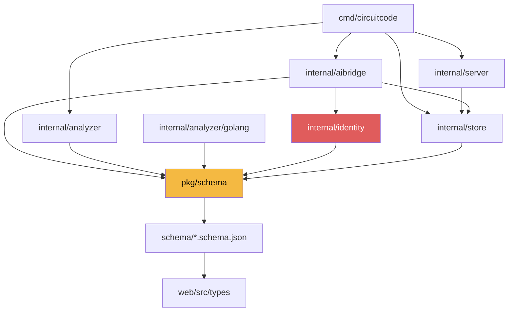

# CircuitCode — Architecture Specification

> **Status:** v1 architecture spec — pending implementation.
> This document is the authoritative reference for the CircuitCode system design. All implementation decisions must be reconcilable with the invariants stated here.

---

## Table of Contents

1. [Mission & Design Philosophy](#1-mission--design-philosophy)
2. [Core Loop](#2-core-loop)
3. [The Chosen Architecture: Thin-Loop with a Hard Kernel](#3-the-chosen-architecture-thin-loop-with-a-hard-kernel)
4. [Dual Identity — The Linchpin](#4-dual-identity--the-linchpin)
5. [The Semantic Model — Six Persisted Files](#5-the-semantic-model--six-persisted-files)
6. [Node & Edge Attributes](#6-node--edge-attributes)
7. [Layer Model (L0–L6)](#7-layer-model-l0l6)
8. [Lock System](#8-lock-system)
9. [Tech Stack](#9-tech-stack)
10. [AI Bridge — The Policy Kernel](#10-ai-bridge--the-policy-kernel)
11. [Guardrails & Invariants](#11-guardrails--invariants)
12. [Monorepo Structure](#12-monorepo-structure)
13. [Distribution Plan](#13-distribution-plan)
14. [MVP Deliverable & Roadmap](#14-mvp-deliverable--roadmap)
15. [Honest Limitations](#15-honest-limitations)
16. [Future Features Backlog](#16-future-features-backlog)
17. [Glossary](#17-glossary)

---

## 1. Mission & Design Philosophy

**CircuitCode** is a *Visual Intent IDE* — the first **Software EDA** (Electronic Design Automation) environment for general-purpose code repositories. It converts an existing software repository into a multi-layer, interactive, circuit-like architecture view and generates an **editable semantic model** that both humans and AI coding agents understand with zero ambiguity.

### What CircuitCode Is NOT

| Category | Why it is excluded |
|---|---|
| Low-code platform | The Git repository remains the single source of truth; CircuitCode generates overlays, never a fork of the code |
| Flowchart / diagram editor | There are no free-floating shapes; every node is backed by a real symbol in the codebase |
| UML tool | No class diagrams, no sequence diagrams drawn by hand; structure is derived from AST and cross-referenced against semantic analysis |
| Graph database | The storage layer is intentionally flat JSON on disk; no graph DB at MVP |

### The EDA Feel — Why It Matters

The editor must feel like **Altium Designer, KiCad, Quartus, or an FPGA block design tool** — not like draw.io, Visio, or Lucidchart. The design metaphors are:

- Every software **module** behaves like an **IC chip** — a black box with named input/output ports and a contract stamped on its package outline.
- **Double-clicking** a node opens its internal architecture recursively, exactly like opening an IC package in a schematic editor.
- **Edges** are nets carrying typed signals, not arrows on a slide.
- **Locks** are solder-mask rules: an AI agent cannot route through a locked region any more than copper can cross a keepout zone.

---

## 2. Core Loop

The fundamental data flow of CircuitCode, from repository source to AI-generated patch:

```mermaid
flowchart LR
    A([Git Repository\nsource of truth]) -->|go/packages\ngo/ssa / cha| B[AST + Type Info]
    B -->|Analyzer\nProvider| C[Raw Graph\nnodes + anchors]
    C -->|Reconciler\nmints / re-attaches nodeId| D[(Semantic Graph\ngraph.json\ncontracts.json)]
    D -->|overlay merge| E[Visual Intent Layer\nintent.json\nlocks.json\nlayout.json]
    E -->|React Flow canvas| F([Human edits\narchitecture])
    F -->|intent delta\nsaved to intent.json| G[Intent Store]
    G -->|Context Packer\ntoken-budgeted bundle| H([AI Provider\nClaude / GPT / Gemini])
    H -->|EditProposal\nstructured output| I[Gate Pipeline\nG1–G6]
    I -->|all gates pass| J[Git Patch\nunified diff]
    J -->|human approval| A
```



**Key invariant:** The cycle is closed at the Git repository. The AI never touches the working tree directly; it emits a structured `EditProposal` that Go validates, gates, and synthesizes into a real unified diff applied in a throwaway `git worktree`.

---

## 3. The Chosen Architecture: Thin-Loop with a Hard Kernel

### Headline

> **Thin-loop with a hard kernel on a schema-first spine.**

### Why This Architecture

The make-or-break problem in any semantic overlay system is **stable node identity**: the same node must keep the same ID across rename, re-parse, gofmt reformat, file-move, and AI patch application. If IDs drift, every overlay — locks, intent, layout, AI guardrails — breaks silently. Every architectural decision flows from solving this one problem correctly first.

The design synthesizes three concerns in deliberate priority order:

| Priority | Concern | Consequence |
|---|---|---|
| 1 | **Schema-first** | Durability. The identity spine and the six persisted files are the permanent asset. All tooling, UI types, and AI schemas are generated from Go structs. |
| 2 | **MVP-first** | Speed. The Go parser + identity reconciler on one real Go repo must ship as a green CI test before any UI work begins. |
| 3 | **AI-bridge-first** | Moat. The gate pipeline is the thing that makes CircuitCode different from a diagram tool with a chat box bolted on. AI edits via intent and emits a git patch only — enforced in Go code, not in prompts. |

The GPU/EDA visual canvas is a **later phase**, built on a proven and stable semantic model. Investing in WebGL before the identity spine is proven would be the classic mistake of building the UI before the data model.

---

## 4. Dual Identity — The Linchpin

Every node in CircuitCode carries two complementary identifiers. Understanding their relationship is a prerequisite for understanding every other part of the system.

### nodeId

```json
"nodeId": "01900f3a-2b1e-7c4d-9a3f-1b2c3d4e5f60"
```

- A **UUIDv7** minted **once** on first discovery of the symbol.
- Immutable for the lifetime of the repository's `.circuitcode/` directory.
- This is **the law** — the key used in every overlay file (`intent.json`, `locks.json`, `layout.json`).
- Never regenerated; never changed by a rename, move, or signature change.

### anchor

```json
{
  "lang": "go",
  "packagePath": "github.com/myorg/myrepo/internal/auth",
  "symbolKind": "func",
  "qualifiedName": "(*SessionManager).Validate",
  "signatureHash": "sha256:a3f1...",
  "span": {
    "startByte": 4096,
    "endByte": 4812,
    "startLine": 142,
    "endLine": 168
  }
}
```

- A **recomputable structural fingerprint** derived from the AST on every build.
- **Advisory** — it is how the system finds where the symbol currently lives in the source.
- Changes when the symbol is renamed, moved, or its signature is modified.
- Never persisted as a primary key; always recomputed.

### The Reconciling Matcher

On each `circuitcode build`, a **tiered scorer** re-attaches existing `nodeId`s to recomputed anchors. The tiers are evaluated in order; the first match wins:

| Tier | Match Criterion | Confidence |
|---|---|---|
| T1 — Exact | `qualifiedName` matches exactly | Certain |
| T2 — Signature-stable rename | `qualifiedName` differs, `signatureHash` + `packagePath` match | High |
| T3 — Package-stable move | `qualifiedName` matches, `packagePath` differs | High |
| T4 — Fuzzy | Same `packagePath` + same `signatureHash` after rename *or* same `qualifiedName` after file-move | Medium — requires `signatureHash` OR `qualifiedName` to anchor |
| T5 — Human confirm | No automatic tier matched | Queued for human resolution |

The `nodeId` ↔ `anchor` history is persisted so that future builds can use prior pairings as evidence in the scorer.

**Result:** a lock placed on `func Validate` in `internal/auth` survives:
- `gofmt` reformat (span bytes shift, qualifiedName unchanged → T1)
- Function rename to `func Check` (signatureHash unchanged → T2)
- File move to `internal/session` (qualifiedName unchanged → T3)
- Function split into two functions (T5 — queued for human confirmation)

### Edge Identity

Edges carry a deterministic ID computed as:

```
edgeId = UUIDv5(namespace, srcNodeId + "->" + dstNodeId + ":" + kind)
```

Edge intent overrides (contract annotations, latency policies) are keyed by `edgeId` in `intent.json`. The namespace UUID is stored in `metadata.json` and is fixed per repository.

### Schema Versioning and Drift

Every persisted file carries a top-level `schemaVersion` (semver string). `metadata.json` is the authoritative version register and holds a `sha256` hash of every other file's content.

| Concern | Mechanism |
|---|---|
| Migrations | Explicit registered up-converters keyed by `fromVersion → toVersion`; applied automatically on load |
| Forward tolerance | Unknown fields are preserved on round-trip so an old CLI never destroys a newer overlay |
| Drift classification | `circuitcode build` emits a drift report: `unchanged / moved / signature-changed / added / removed` |
| Orphan handling | An overlay entry (`intent` / `lock`) whose `nodeId` fails reconciliation is **quarantined** — never deleted — and added to a human-resolve queue |

---

## 5. The Semantic Model — Six Persisted Files

All files live under `.circuitcode/` in the target repository root. They are split along three strict axes.

### The Three Axes — Hard Rule

> **HARD RULE:** Deleting `graph.json`, `contracts.json`, or `layout.json` must lose **zero** semantic information, because all irreplaceable human and AI work lives in `intent.json` and `locks.json`, keyed by `nodeId`s that the matcher re-binds on the next build.

| File | Axis | Regenerable? | Hand-editable? | Description |
|---|---|---|---|---|
| `graph.json` | DERIVED | Yes — safe to delete | Never | Canonical nodes + edges; every node has `level`, `parentId`, `childIds` |
| `contracts.json` | DERIVED | Yes — safe to delete | Never | Observed contracts derived from code (Go function signatures first) |
| `intent.json` | INTENT | **Never** — irreplaceable | Yes (human + AI via bridge) | Semantic overrides keyed by `nodeId`; the durable human/AI asset |
| `locks.json` | INTENT | **Never** — irreplaceable | Human only | Lock state per `nodeId`; AI must respect these unconditionally |
| `layout.json` | VIEW | Yes — regenerated on first view | Via canvas drag | Only `{x, y, w, h, collapsed, portSide}` per `nodeId` per named view; **nothing semantic** |
| `metadata.json` | CROSS-CUTTING | Partially — content hashes regenerated | Never | Schema versions, generator version, repo commit SHA, per-file content hashes, ID-namespace UUID |

### graph.json — Schema

```json
{
  "schemaVersion": "1.0.0",
  "generatedAt": "2026-06-28T00:00:00Z",
  "nodes": [
    {
      "nodeId": "01900f3a-2b1e-7c4d-9a3f-1b2c3d4e5f60",
      "anchor": {
        "lang": "go",
        "packagePath": "github.com/myorg/myrepo/internal/auth",
        "symbolKind": "func",
        "qualifiedName": "(*SessionManager).Validate",
        "signatureHash": "sha256:a3f1b2c3",
        "span": { "startByte": 4096, "endByte": 4812, "startLine": 142, "endLine": 168 }
      },
      "level": 4,
      "parentId": "01900f3a-0000-7000-0000-000000000001",
      "childIds": [],
      "status": "active"
    }
  ],
  "edges": [
    {
      "edgeId": "f47ac10b-58cc-4372-a567-0e02b2c3d479",
      "srcNodeId": "01900f3a-2b1e-7c4d-9a3f-1b2c3d4e5f60",
      "dstNodeId": "01900f3a-ffff-7fff-ffff-ffffffffffff",
      "kind": "call",
      "callEdgeKind": "static"
    }
  ]
}
```

Layers L0–L6 are **not** separate files. Each node carries a `level` field (0–6) plus `parentId`/`childIds`. "Open the IC" in the UI = follow `childIds` of a node, loading them lazily.

### intent.json — Schema

```json
{
  "schemaVersion": "1.0.0",
  "nodes": {
    "01900f3a-2b1e-7c4d-9a3f-1b2c3d4e5f60": {
      "description": "Validates a session token; must return in < 2ms under p99 load.",
      "owner": "auth-team",
      "status": "stable",
      "risk": "high",
      "tags": ["auth", "critical-path"],
      "comments": [],
      "securityCritical": true,
      "performanceCritical": true,
      "aiEditable": false,
      "desiredChange": null,
      "expectedContracts": {
        "inputs": [{ "name": "token", "type": "string" }],
        "outputs": [{ "name": "session", "type": "*Session" }, { "name": "err", "type": "error" }],
        "preconditions": ["token must be non-empty"],
        "postconditions": ["returned session is non-nil iff err is nil"]
      }
    }
  },
  "edges": {}
}
```

### locks.json — Schema

```json
{
  "schemaVersion": "1.0.0",
  "locks": {
    "01900f3a-2b1e-7c4d-9a3f-1b2c3d4e5f60": {
      "state": "Locked",
      "scope": "subtree",
      "actorPolicy": "humanOnly",
      "lockedBy": "alice@example.com",
      "lockedAt": "2026-06-01T09:00:00Z",
      "reason": "Security audit in progress — no modifications until sign-off."
    }
  }
}
```

### Serialization Standard

All six files use **canonical JSON** (RFC 8785 JSON Canonicalization Scheme):

- Keys sorted lexicographically at every depth.
- Numbers normalized (no trailing zeros, no `-0`).
- Line endings: LF only.
- No volatile fields (e.g., timestamps) inside files that are committed; build timestamps go in `metadata.json` only, and `metadata.json` is not committed — only its hash is.

**Go structs are the single source of truth.** The pipeline is:

```
pkg/schema/*.go
    │  //go:generate invopop/jsonschema (Draft 2020-12)
    ▼
schema/*.schema.json
    │  json-schema-to-typescript
    ▼
web/src/types/*.ts      ← UI never hand-writes graph types
```

The UI never imports Go types directly and never hand-writes JSON-schema-derived types. If the Go structs change, `make gen` regenerates everything; CI fails on stale generated files.

---

## 6. Node & Edge Attributes

### Node Attributes

| Attribute | Axis | Type | Notes |
|---|---|---|---|
| `nodeId` | DERIVED | UUIDv7 string | Minted once; immutable |
| `anchor` | DERIVED | Anchor object | Recomputed each build; advisory |
| `level` | DERIVED | int (0–6) | L0=System … L6=Data Flow |
| `parentId` / `childIds` | DERIVED | UUIDv7 string(s) | Containment tree |
| `status` | DERIVED/INTENT | enum | `active / unresolved / deprecated` |
| `language` | DERIVED | string | `go / ts / rust / python` |
| `directory` | DERIVED | string | Repo-relative path |
| `files` | DERIVED | []string | Source files contributing to this node |
| `functions` | DERIVED | []string | qualifiedNames of contained functions (L2+) |
| `dependencies` | DERIVED | []nodeId | Direct outgoing edges |
| `contracts` (observed) | DERIVED | Contract object | From `contracts.json` |
| `inputs` / `outputs` | DERIVED | []Port | Typed ports |
| `coverage` | DERIVED | float | Test coverage percentage |
| `description` | INTENT | string | Human/AI semantic description |
| `owner` | INTENT | string | Team or individual responsible |
| `risk` | INTENT | enum | `low / medium / high / critical` |
| `tags` | INTENT | []string | Free-form |
| `comments` | INTENT | []Comment | Threaded annotations |
| `securityCritical` | INTENT | bool | Triggers G2 enforcement |
| `performanceCritical` | INTENT | bool | Informational; future SLO enforcement |
| `aiEditable` | INTENT | bool | `false` = AI bridge rejects edits |
| `desiredChange` | INTENT | string | Human-authored change request to AI |
| `expectedContracts` | INTENT | Contract object | Declared intent; G3 checks against observed |
| `locked` | INTENT (locks.json) | LockState | See Lock System section |

### Edge Attributes

Edges are first-class citizens. A broken contract on an edge must generate a visible warning in the UI (red/dashed edge rendering) and a `Violation` record in the gate pipeline.

| Attribute | Axis | Description |
|---|---|---|
| `edgeId` | DERIVED | UUIDv5 deterministic |
| `srcNodeId` / `dstNodeId` | DERIVED | nodeId references |
| `kind` | DERIVED | `call / import / data / inherit / implement` |
| `callEdgeKind` | DERIVED | `static / dynamic-CHA` |
| `inputType` / `outputType` | DERIVED/INTENT | Type names of the transported value |
| `protocol` | INTENT | Transport protocol (`grpc / http / chan / direct`) |
| `contract` | INTENT | Observed + expected pre/post |
| `precondition` / `postcondition` | INTENT | Logical assertions |
| `latency` | INTENT | SLO target (e.g., `p99 < 5ms`) |
| `retryPolicy` | INTENT | Max retries, backoff |
| `timeout` | INTENT | Hard deadline |
| `errors` | INTENT | Known error modes |

---

## 7. Layer Model (L0–L6)

Layers are **views over one node/edge store** — not separate stores, not separate files. Every node has a single `level` field; the parent/child containment tree provides unlimited recursive zoom.

| Level | Name | Granularity | Typical Node Examples |
|---|---|---|---|
| L0 | System | The entire repository | The repo itself; external system boundaries |
| L1 | Services | Major deployable units | HTTP server, background worker, CLI entrypoint |
| L2 | Modules | Go packages / TS modules | `internal/auth`, `internal/store` |
| L3 | Components | Logical groupings within a package | `SessionManager`, `TokenCache` (types/structs) |
| L4 | Functions | Individual exported + key internal functions | `(*SessionManager).Validate` |
| L5 | Control Flow | Basic block graph within a function | CFG nodes from SSA `BasicBlock.Succs/Preds` |
| L6 | Data Flow | Def-use / value propagation | SSA `Value.Operands/Referrers` |

**"Open the IC"** in the UI = lazy mount of the next level down by following `childIds`. L5 and L6 are computed **lazily per function on double-click** because SSA analysis is memory-heavy and most functions are never inspected at that depth.

**Cross-edges** connect nodes at any level and are stored in the same edge list with explicit `srcLevel` and `dstLevel` fields so the UI can filter by zoom depth.

---

## 8. Lock System

### Lock States

| State | Meaning | AI behaviour |
|---|---|---|
| `Unlocked` | No restriction | AI may propose edits if `aiEditable=true` |
| `Locked` | Frozen by human decision | AI proposals touching this node are rejected at G2 |
| `ReviewRequired` | Changes need approval before apply | AI proposals are flagged `BLOCKED`; surfaced to reviewer |
| `Deprecated` | Scheduled for removal; no new modifications | AI proposals rejected at G2 |
| `Experimental` | Unstable; changes expected | AI proposals allowed; tagged in audit trail |
| `SecurityCritical` | Highest sensitivity | AI proposals always rejected at G2 regardless of `aiEditable` |

### Lock Scope

Each lock entry carries a `scope` field:

- `self` — applies to the locked node only.
- `subtree` — applies to the node and all `childIds` transitively.

### Actor Policy

- `humanOnly` — only a human can modify the node, through the intent editor or direct source edit followed by `circuitcode build`.
- `aiAllowed` — AI may propose changes subject to all gate checks passing.

**The lock system is enforced in Go code (G2 gate), not in prompts.** There is no prompt instruction that can override a `Locked` or `SecurityCritical` state; the gate pipeline re-derives every touched `nodeId` from the re-parsed patched bytes and rejects unconditionally.

---

## 9. Tech Stack

### Component Summary Table

| Component | Technology | Rationale |
|---|---|---|
| Parser — Phase 1 (Go) | `golang.org/x/tools/go/packages` (LoadAllSyntax + NeedModule) | Full type-checked AST; handles modules, build tags, cgo |
| Type resolution | `go/types` | Resolves qualified names and signatures for L0–L4 |
| Control flow (L5) | `golang.org/x/tools/go/ssa` — `BasicBlock.Succs/Preds` | SSA CFG is the canonical representation of intra-function control flow |
| Data flow (L6) | `golang.org/x/tools/go/ssa` — `Value.Operands/Referrers` | Def-use graph maps directly to value flow |
| Call graph | `golang.org/x/tools/go/callgraph/cha` | **Why CHA:** it is the only algorithm in `x/tools` documented as sound on partial programs and libraries without a `main` entry point. RTA and VTA require a whole-program reachable from `main`/`test`. CHA over-approximates interface dispatch but produces no false negatives. Call edges are tagged `static` or `dynamic-CHA`. |
| Identity spine | Custom `internal/identity` package | UUIDv7 minting + tiered anchor matcher + reconciler |
| Graph store | Flat canonical JSON on disk | Simplest correct implementation; no graph DB at MVP |
| Derived index (large repos) | Optional SQLite / DuckDB in a cache directory, never committed | Query acceleration only; rebuilt from JSON on demand |
| Visual editor — Phase 2 | React 19 + TypeScript + **React Flow (xyflow v12, MIT)** | MIT licence (no paywalled features); first-class support for compound/group nodes, custom handles as IC ports |
| Auto-layout | **elkjs** (ELK `layered`, `edgeRouting=ORTHOGONAL`, `portConstraints=FIXED_ORDER`) in a Web Worker | Deterministic hierarchical layout; orthogonal net routing matches EDA aesthetic; runs off-thread to keep canvas at 60 fps |
| Visual editor — Phase 3+ (gated) | **PixiJS v8 (WebGL)** behind a `Renderer` interface | Triggered only if a 50k-node real-repo benchmark fails React Flow's frame budget. WebGL (not WebGPU) per PixiJS production recommendation. The `Renderer` interface (`mount / setViewport / applyDelta / hitTest / setLOD`) consumes the same ViewModel so the swap is non-breaking. |
| State management | Zustand store | Single ViewModel shared between React Flow and the eventual PixiJS renderer |
| Server | Go `net/http` + `go:embed` | Single binary; embeds pre-built `web/dist`; owns all file I/O for the six persisted files |
| CLI | `cobra` | Subcommands: `build`, `serve`, `patch`, `check`, `plugin` |
| JSON Schema codegen | `invopop/jsonschema` (Draft 2020-12) | Driven by Go struct tags; single source of truth |
| TypeScript type codegen | `json-schema-to-typescript` | Run in CI via `pnpm gen:types`; stale output fails the build |
| AI bridge | Custom `internal/aibridge` package | Provider-agnostic `Provider` interface; gate pipeline G1–G6 |
| Git patch application | Throwaway `git worktree` (or `go-git` scratch clone) | The user's working tree is never touched |
| Build tool | Makefile / Taskfile | NOT Nx / Turborepo / Bazel at MVP (one Go module + one JS package) |

### Parser Degradation Strategy

If the target repository does not compile:

1. Emit L0–L3 structure from **syntax only** (`go/parser` without type-checking).
2. Mark all L4–L6 nodes `status: "unresolved"`.
3. Compute L5/L6 lazily per function on double-click to avoid loading the full SSA graph into memory at startup.

### Language Plugin Boundary

The language plugin boundary is a **process/interface-level contract**, not a shared AST library. This is a hard rule that prevents import cycles.

```go
// pkg/schema/provider.go
package schema

// RawGraph nodes carry the anchor only — never a nodeId.
// NodeId minting happens in the language-agnostic Reconciler.
type RawGraph struct {
    Nodes []RawNode
    Edges []RawEdge
}

// Provider is the interface every language backend must satisfy.
type Provider interface {
    Lang() string
    Analyze(ctx context.Context, repoRoot string) (RawGraph, error)
}
```

The **Reconciler** in `internal/identity` is the only component that mints `nodeId`s. Language providers never see `nodeId`s; they only produce `RawGraph` with `Anchor` values. This separation means:

- Go ships in Phase 1.
- TypeScript, Rust, and Python are registered stubs behind a capability flag, later implemented using **tree-sitter** for parsing and **SCIP** for cross-file name resolution, behind the same `Provider` interface.
- A **JSON Schema + conformance test suite** for the anchor shape is published so future language backends cannot drift from the contract.

### Visual Canvas Performance Rules

The following rules apply to the React Flow canvas to maintain frame budget at scale:

| Rule | Implementation |
|---|---|
| Never render all nodes simultaneously | `onlyRenderVisibleElements: true` on the React Flow instance |
| Level-of-detail by zoom | Three tiers via `useViewport().zoom`: full detail > 0.4; label-only 0.15–0.4; icon-only < 0.15 |
| Memoize all components | Every node and edge component wrapped in `React.memo`; stable prop references enforced |
| Custom minimap | Replace default MiniMap (redraws every node = fatal at scale) with a single-pass `Canvas2D` minimap; only L0–L2 nodes rendered in the minimap |
| Auto-layout off-thread | ELK runs entirely in a Web Worker; results posted as a coordinate delta applied to layout.json |
| Lazy IC opening | Double-clicking a node fetches its `childIds` from the server and mounts them; the parent canvas does not pre-render unexpanded subtrees |

---

## 10. AI Bridge — The Policy Kernel

The AI bridge is the component that makes CircuitCode different from a diagram tool with a chat box bolted on. Its design principle is:

> **Treat the LLM as a sandboxed function with NO filesystem access and NO git access.**

The LLM receives a token-budgeted context bundle, emits a structured `EditProposal`, and Go does all the rest. The model never chooses what gets applied. Go applies; Go gates.

### Gate Pipeline Flow

```mermaid
flowchart TD
    A([Human edits intent\nintent.json delta]) --> B[Context Packer\ntoken-budgeted ContextBundle\nwith content hash]
    B --> C([LLM Provider\nClaude / GPT / Gemini\nforced tool-use / structured output])
    C --> D[EditProposal\nrationale + []Edit]

    D --> G1{G1\nPatchApplyCheck\ngit apply --check --3way}
    G1 -->|fail| V[Violation record]
    G1 -->|pass| G2{G2\nLockScopeCheck\nre-parse patched tree\nhunk → nodeId attribution}
    G2 -->|fail| V
    G2 -->|pass| G3{G3\nContractDiffCheck\nsignatureHash delta\non exported symbols}
    G3 -->|fail| V
    G3 -->|pass| G4{G4\nHiddenDepCheck\nimport/call-graph delta\nvs graph.json}
    G4 -->|fail| V
    G4 -->|pass| G5{G5\nLayerScopeCheck\ntouched nodes within\nintent's layer/subtree}
    G5 -->|fail| V
    G5 -->|pass| G6{G6\nBuild/Test\ngo build ./...\ngo test on touched pkgs}
    G6 -->|fail| V
    G6 -->|pass| P([Git Patch\nread for human approval])

    V --> R{Retry?\nattempt < 3}
    R -->|yes — feed violations back| C
    R -->|no| BL([BLOCKED\nbest attempt + violations\nsurfaced to human])
```

### Step-by-Step Description

**Step 1 — Context Packer**

The Context Packer assembles a deterministic, token-budgeted `ContextBundle` (with a content hash) containing:

- The `IntentDelta`: the human's edit to `intent.json` — what changed, what the human wants.
- For each target node: its `anchor` + the **verbatim current source slice** of its `span` bytes.
- The lock state and contract of every target node **and every first-degree neighbour**.
- An "editable surface" manifest: which `nodeId`s are `aiEditable=true` vs `Locked / ReviewRequired / Deprecated`.

Scope is limited to the graph neighbourhood of the target nodes. The full repository is never dumped into context.

**Step 2 — EditProposal Schema**

The LLM must emit a strictly schema-constrained `EditProposal` via forced tool-use or structured output mode. It never emits a raw unified diff — models routinely botch `@@ hunk headers` and line number arithmetic.

```json
{
  "rationale": "Extracted the token expiry check into a helper to reduce duplication.",
  "edits": [
    {
      "targetNodeId": "01900f3a-2b1e-7c4d-9a3f-1b2c3d4e5f60",
      "anchor": { "...": "current anchor for optimistic-concurrency check" },
      "op": "ReplaceSymbolBody",
      "filePath": "internal/auth/session.go",
      "expectedOldText": "func (s *SessionManager) Validate(token string) (*Session, error) {\n\t// ... verbatim current source ...\n}",
      "newText": "func (s *SessionManager) Validate(token string) (*Session, error) {\n\t// ... proposed new source ...\n}"
    }
  ]
}
```

**Supported `op` values:**

| op | Meaning |
|---|---|
| `ReplaceSymbolBody` | Replace everything between the symbol's braces |
| `ReplaceSpan` | Replace an arbitrary byte span (with `expectedOldText` guard) |
| `InsertBefore` | Insert text immediately before the target symbol |
| `InsertAfter` | Insert text immediately after the target symbol |
| `CreateFile` | Create a new file (requires explicit human approval in the gate) |
| `DeleteSymbol` | Delete a symbol (requires explicit human approval; queued, never auto-applied) |

**Step 3 — Go Synthesis**

Go validates `expectedOldText` by byte-comparing it against the current span (optimistic-concurrency guard against stale context). If the text matches, Go splices `newText` and synthesises the unified diff itself inside a throwaway `git worktree`. The final artifact is a real unified diff; the `EditProposal` structured form is the model's input language only.

**Step 4 — Gate Pipeline (FAIL-CLOSED)**

Each gate returns a structured `Violation`:

```go
type Violation struct {
    Rule        string // "G1_PATCH_APPLY" | "G2_LOCK_SCOPE" | ...
    NodeID      string
    Expected    string
    Actual      string
    Explanation string
}
```

| Gate | Check | Failure mode |
|---|---|---|
| G1 `PatchApplyCheck` | `git apply --check --3way` on the throwaway worktree | Non-zero exit → reject |
| G2 `LockScopeCheck` | Re-parse the **patched** tree; map every diff hunk's byte span to its enclosing symbol → `nodeId`; reject if any touched `nodeId` is `Locked / SecurityCritical / ReviewRequired-without-approval / Deprecated` or `aiEditable=false`. A hunk that maps to **no** node is also a violation (fail-closed). A hunk straddling multiple declarations is attributed to **all** (union). | `LOCK_VIOLATION` |
| G3 `ContractDiffCheck` | Recompute `signatureHash` of touched exported symbols in the patched tree; a changed hash on a node whose expected contract is `frozen` → violation. v1 honest scope: Go signatures only. | `CONTRACT_BREAK` |
| G4 `HiddenDepCheck` | Diff the import/call graph of the patched source vs `graph.json`; any **new** cross-node edge not in the intent's declared `Dependencies` → violation. Allowlist: stdlib packages + edges already in `graph.json`. | `HIDDEN_DEP` |
| G5 `LayerScopeCheck` | Every touched node must be within the layer/subtree that the human's intent edit was scoped to. | `LAYER_SCOPE_VIOLATION` |
| G6 `Build/Test` | `go build ./...` + targeted `go test ./...` on all packages containing touched nodes. | `BUILD_FAILURE` / `TEST_FAILURE` |

**Step 5 — Retry Loop and Audit Trail**

On violation, the structured `Violation` records are fed back to the same LLM provider for a capped retry loop (maximum 3 attempts). On exhaustion, the system returns the best attempt alongside all violations as `BLOCKED` — **never auto-applied**.

Every attempt is logged:

```json
{
  "attemptId": "uuid",
  "provider": "anthropic",
  "model": "claude-opus-4-5",
  "promptHash": "sha256:...",
  "proposal": { "...": "..." },
  "violations": [],
  "outcome": "applied | blocked | retrying"
}
```

This audit log feeds the review/approval workflow.

**Critical invariant:** The kernel never trusts the model's claim about what it touched. Every guardrail is re-derived from the actual patched bytes using `go/packages` — the same machinery as the identity spine. Therefore, prompt injection cannot bypass locks; the worst case is wasted retry attempts.

---

## 11. Guardrails & Invariants

These are hard, enforced invariants — not guidelines and not prompt instructions. Each is enforced mechanically in Go code.

### Invariant Table

| # | Invariant | Enforcement mechanism | Location in code |
|---|---|---|---|
| I1 | **Git is the single source of truth.** The semantic model is an overlay, never a fork of the code. | `graph.json` and `contracts.json` are always regenerated from the live repo; the server has no path to modify source files except via the gate-approved patch. | `internal/store`, `internal/server` |
| I2 | **AI generates git patches only; it never edits source directly.** | The LLM provider interface has no filesystem or git access. Go synthesises and applies the diff in a throwaway `git worktree`. | `internal/aibridge/kernel.go` |
| I3 | **Never modify Locked nodes.** | G2 gate re-parses the patched tree, re-attributes every diff hunk to its `nodeId`(s), and rejects unconditionally if any is `Locked` / `SecurityCritical` / `ReviewRequired` without approval / `Deprecated`. Fail-closed: a hunk with no attributable node is also rejected. | `internal/aibridge/gates/g2_lockscope.go` |
| I4 | **Never violate contracts.** | G3 gate diffs `signatureHash` of exported symbols in the patched tree vs the frozen expected contract. v1 scope: Go function signatures only. | `internal/aibridge/gates/g3_contract.go` |
| I5 | **Never change architecture unless requested; never bypass layer restrictions.** | G5 gate maps every touched node to its layer and checks it is within the subtree declared in the intent delta. | `internal/aibridge/gates/g5_layerscope.go` |
| I6 | **Never create hidden dependencies.** | G4 gate diffs the import/call graph of the patched source vs `graph.json`; any new cross-node edge not in the intent's declared `Dependencies` is rejected. | `internal/aibridge/gates/g4_hiddendep.go` |
| I7 | **Never delete nodes without confirmation.** | `DeleteSymbol` ops in an `EditProposal` are queued for explicit human approval and never auto-applied. Overlay orphans (reconciliation failures) are quarantined, never deleted. | `internal/aibridge/kernel.go`, `internal/identity/reconciler.go` |
| I8 | **Always explain conflicts.** | Every gate failure produces a structured `Violation` record with `rule`, `nodeId`, `expected`, `actual`, and `explanation`. These are surfaced to the human in the review workflow, not swallowed silently. | `internal/aibridge/gates/*.go` |
| I9 | **Determinism and clean diffs.** | All six files use canonical JSON (RFC 8785). Layout positions are isolated in `layout.json` so no semantic file ever changes due to a drag-and-drop operation. `circuitcode check` is a CI gate that fails a PR on unresolved drift, lock violations, or contract violations. | `internal/store/canonical.go`, `cmd/circuitcode/check.go` |
| I10 | **Overlay orphans are quarantined, never deleted.** | The reconciler places unresolvable `nodeId` entries in a quarantine queue with a timestamp and a human-resolve prompt. The quarantine queue is written to `metadata.json`. The six primary files are never modified to remove an orphan. | `internal/identity/reconciler.go` |

---

## 12. Monorepo Structure

### Why the Naive Flat Layout Was Rejected

The project's initial proposal was a flat top-level structure:

```
# REJECTED — do not use
parser/
graph-engine/
visual-editor/
ai-bridge/
git-patch/
language-go/
language-ts/
language-rust/
language-python/
docs/
```

This layout has three fatal problems:

1. **Mixes orthogonal axes at the same level.** Pipeline stages (`parser`, `graph-engine`, `ai-bridge`, `git-patch`) and language plugins (`language-go`, `language-ts`) are different organisational dimensions. Flattening them together makes the dependency structure invisible.

2. **Import-cycle trap.** The parser needs Go-specific AST logic that would live in `language-go`, but `language-go` needs the parser's node types to satisfy the `Provider` interface. The Go compiler rejects this cycle. There is no workaround that does not involve either a messy third package or duplicated types.

3. **Front-loads four language plugins before the Go-first MVP is proven.** Creating directories for TS, Rust, and Python before the identity spine is green in CI creates psychological pressure to implement them prematurely and bloats the scope of Phase 1.

### Adopted Layout

The chosen layout is a **single Go-module-rooted monorepo** with one JS workspace:

```
circuitcode/                        # go.mod: module github.com/ihacked07/circuitcode
├── cmd/
│   └── circuitcode/
│       └── main.go                 # CLI entry: build | serve | patch | check | plugin
├── pkg/
│   └── schema/                     # PUBLIC — the single source of truth for all types
│       ├── node.go                 #   Node, Anchor, Edge, RawGraph structs
│       ├── intent.go               #   Intent, Lock, Contract structs
│       ├── provider.go             #   Provider interface
│       └── gen.go                  #   //go:generate → schema/*.schema.json
├── internal/
│   ├── analyzer/
│   │   ├── provider.go             #   registry of registered providers
│   │   └── golang/                 #   Phase-1 provider: go/packages + go/ssa + cha
│   │       ├── analyzer.go
│   │       ├── ssa.go              #     L5/L6 — lazy, per-function
│   │       └── callgraph.go        #     CHA call edges
│   ├── identity/                   #   ★ THE CORE — UUIDv7 minting + reconciler
│   │   ├── minter.go               #     mints UUIDv7 on first discovery
│   │   ├── anchor.go               #     Anchor hash computation
│   │   └── reconciler.go           #     tiered scorer + quarantine queue
│   ├── store/                      #   reads/writes the six persisted files
│   │   ├── store.go
│   │   └── canonical.go            #     RFC 8785 serialization
│   ├── server/                     #   net/http server + go:embed of web/dist
│   │   └── server.go
│   └── aibridge/                   #   AI policy kernel
│       ├── kernel.go               #     context packer + retry loop + audit log
│       ├── providers/              #     thin adapter per LLM (Claude, GPT, Gemini)
│       └── gates/
│           ├── g1_patchapply.go
│           ├── g2_lockscope.go
│           ├── g3_contract.go
│           ├── g4_hiddendep.go
│           ├── g5_layerscope.go
│           └── g6_buildtest.go
├── web/                            # pnpm workspace — React + React Flow + Vite
│   ├── package.json
│   ├── vite.config.ts
│   └── src/
│       ├── types/                  #   TS types generated from JSON Schema (NEVER hand-written)
│       ├── components/
│       │   ├── canvas/             #     React Flow canvas + custom nodes/edges
│       │   ├── minimap/            #     Canvas2D minimap (replaces default React Flow minimap)
│       │   └── inspector/          #     intent editor panel
│       └── store/                  #     Zustand ViewModel
├── schema/                         # generated JSON Schemas — public contract
│   ├── node.schema.json
│   ├── intent.schema.json
│   └── ...
├── testdata/
│   └── fixtures/
│       ├── simple-go-repo/         #   small self-contained Go repo for unit tests
│       └── mutation-corpus/        #   gofmt / rename / move / split mutations for ID-stability tests
├── docs/
│   └── ARCHITECTURE.md
├── Makefile
└── .github/
    └── workflows/
        └── ci.yml
```

### Dependency Direction — Hard Rule

Dependencies must flow in **one direction only**. The Mermaid diagram below is the enforced constraint; CI uses `depguard` to reject any `import` that violates an arrow's direction.



`pkg/schema` is the only package that every other component is allowed to import. No component inside `internal/` may import another `internal/` package that is higher in the hierarchy (e.g., `internal/aibridge` must not import `internal/server`). `pkg/schema` itself has **zero internal imports**.

### Build Targets

| Target | Command | Description |
|---|---|---|
| Generate schemas | `make gen` | Runs `go generate ./pkg/schema/...` → emits `schema/*.schema.json` → runs `pnpm gen:types` → emits `web/src/types/*.ts` |
| Build web | `make web` | `vite build` → `web/dist/` |
| Build binary | `make build` | `go build` with `web/dist` embedded via `go:embed` |
| Test | `make test` | `go test ./...` + `pnpm test` |
| Check generated files | `make check-gen` | Fails if any generated file differs from what `make gen` would produce (CI gate) |
| Lint deps | `make lint-deps` | `depguard` enforces one-way import direction |

---

## 13. Distribution Plan

CircuitCode has three thin entrypoints over **one core**, built and shipped in sequence — not in parallel.

### Phase 1 — Single Go Binary

```
go install github.com/ihacked07/circuitcode/cmd/circuitcode@latest
```

- `circuitcode build` — runs the analyzer + reconciler over the target repo, emits `.circuitcode/` files.
- `circuitcode serve` — starts a localhost HTTP server at `http://localhost:7823`, serving the embedded React SPA.
- `circuitcode patch` — applies a human-reviewed `EditProposal` from a JSON file.
- `circuitcode check` — CI gate: fails on unresolved drift, lock violations, or contract violations.
- **No Node runtime required at the user's machine.** The SPA is pre-built and embedded via `go:embed`.

### Phase 3 — Claude Code Plugin Wrapper

A thin plugin distribution channel layered on top of the binary:

```
.claude-plugin/
├── plugin.json       # plugin manifest
└── SKILL.md          # /circuitcode skill — shells out to the circuitcode binary
```

The plugin is a **distribution channel**, not the product. It provides slash commands and agents that invoke `circuitcode build`, `circuitcode serve`, and `circuitcode patch` as subprocesses. CircuitCode's value does not depend on Claude Code; the plugin simply makes the tool discoverable in that environment.

### Phase 4 — Wails v3 Desktop Shell (Optional)

A native desktop application built with **Wails v3** that wraps the same Go core and serves the same React SPA inside a native webview. This adds native file-system integration and OS-level window management. The Go core and the SPA are identical to Phase 1; Wails is a third thin shell over the same foundation.

---

## 14. MVP Deliverable & Roadmap

### MVP Definition — The Linchpin Test

The first deliverable de-risks the single most dangerous assumption before any UI work begins: that node identity is stable across real-world source mutations.

**Deliverable:** `circuitcode build` + the identity spine + an ID-stability test harness.

**Definition of done:** The following test is **green in CI**:

1. Run `circuitcode build` over one real Go repository. Verify the output `graph.json` is schema-valid and every node carries a `nodeId` (UUIDv7) and an `anchor`.
2. Place a lock on a specific node in `locks.json` (keyed by its `nodeId`).
3. Apply real mutations to the source, one at a time: (a) `gofmt` reformat, (b) rename the locked function, (c) move its file, (d) split it into two functions.
4. After each mutation, re-run `circuitcode build`.
5. Assert the reconciler re-attaches the original `nodeId` to the correct post-mutation symbol with **zero orphans** for mutations (a)–(c). Assert mutation (d) produces exactly one quarantine entry (human-confirm queue).
6. Assert the lock record in `locks.json` still binds to the correct symbol after mutations (a)–(c).

This test must be in `testdata/fixtures/mutation-corpus/` and must run in `go test ./...` with no external dependencies.

### Roadmap

| Phase | ID | Deliverable | Gate to proceed |
|---|---|---|---|
| 0 | P0 | Spec + ID algebra + canonical serializer + JSON Schema | Document reviewed; `canonical.go` has round-trip tests |
| 1 | P1 | Parser → `graph.json`; reconciler; `circuitcode build` + `check`; ID-stability test green | Linchpin test green in CI |
| 2 | P2 | React Flow canvas; intent editor; save `intent.json`; prove overlay survives re-parse | One real engineer can load their own repo, annotate a node, and survive a rebuild |
| 3 | P3 | AI policy kernel; gate pipeline G1–G6; `circuitcode patch`; full core loop | A lock placed in UI blocks an AI patch targeting that node |
| 4 | P4 | Hardening; audit trail; quarantine UI; review workflow; demo-quality polish | Can be shown to external users without embarrassment |
| 5 | P5 | Second language (TypeScript via tree-sitter + SCIP); multi-language overlay; gated WebGL canvas | TS provider passes conformance test suite; WebGL gate triggered only by benchmark failure |

---

## 15. Honest Limitations

The following limitations are known and accepted at v1. They are documented here so that contributors do not design around them accidentally.

| Limitation | Details | Mitigation plan |
|---|---|---|
| **Contract enforcement is Go-signature-only at v1** | `precondition`, `postcondition`, `latency`, `retryPolicy`, and `timeout` fields exist in the schema and are stored in `intent.json`, but G3 only checks `signatureHash` (i.e., the Go function signature). Semantic pre/post enforcement is not yet implemented. | Phase 5+: integrate a lightweight contract-checking pass (e.g., comment-directive parsing, or a formal spec language). |
| **CHA over-approximates dynamic dispatch** | CHA (Class Hierarchy Analysis) is sound — it produces no false negatives — but it over-approximates interface dispatch. A call through an interface type gets an edge to every type that implements the interface, which can produce spurious edges in heavily interface-driven Go code. | Edges are tagged `callEdgeKind: "dynamic-CHA"` so users can filter them. Future: RTA/VTA for whole-program repos that have a `main` entry point. |
| **Incomplete repos yield L0–L3 only** | A repo that does not compile (missing dependencies, build errors) cannot produce type information. L4–L6 nodes are marked `status: "unresolved"`. | Syntax-only parse provides L0–L3 structure. Document in `circuitcode build` output. |
| **React Flow has a zoom-out ceiling on very large repos** | React Flow renders DOM nodes; at 50k+ nodes the frame budget collapses regardless of `onlyRenderVisibleElements`. | The gated PixiJS v8 (WebGL) renderer is the planned response. It is only built if a 50k-node benchmark fails the React Flow budget. |
| **Multi-language fidelity is uneven** | Go has full semantic analysis at v1. TypeScript, Rust, and Python are registered stubs. Until each gets a real semantic backend (tree-sitter + SCIP), their L4–L6 nodes will be `unresolved`. | Sequenced by Phase 5+. The `Provider` interface is stable so backends can be added without touching core. |
| **No collaborative real-time editing at v1** | `intent.json` and `locks.json` are single-writer files. Concurrent edits from multiple users require a last-write-wins merge or a CRDT layer not designed yet. | Phase 5+: file-based locking for v1; CRDT overlay for collaborative mode in a later phase. |

---

## 16. Future Features Backlog

The following capabilities are in scope for future phases but are **out of scope for the MVP**. They are listed here to prevent scope creep and to give future contributors a clear picture of the intended direction.

| # | Feature | Notes |
|---|---|---|
| B01 | Git diff visualization | Show architectural delta between two commits or branches |
| B02 | Architecture drift detection | Automated alert when the live repo diverges from a pinned intent snapshot |
| B03 | Automatic AST regeneration on file-save | Watch mode for `circuitcode build` triggered by `fsnotify` |
| B04 | Test coverage overlay | Map coverage percentages from `go test -coverprofile` onto nodes |
| B05 | Performance overlay | Annotate nodes with profiling data (pprof) |
| B06 | Security overlay | Integrate static analysis results (govulncheck, gosec) as node annotations |
| B07 | Storage overlay | Annotate nodes with database schema relationships |
| B08 | Network / latency overlay | Annotate edges with observed p50/p99 latency from distributed tracing |
| B09 | Live metrics overlay | Connect to Prometheus / OpenTelemetry; animate edges with live RPS |
| B10 | Observability overlay | Correlate log patterns with specific nodes |
| B11 | AI suggestions (unprompted) | AI proactively identifies architectural smells and proposes improvements |
| B12 | Collaborative editing | Multi-user real-time intent editing with CRDT merge |
| B13 | Branch comparison | Side-by-side architecture view of two branches |
| B14 | PR visualization | Annotate a pull request's diff onto the architecture graph |
| B15 | Review mode | Read-only shareable architecture snapshot for design review |
| B16 | Design approval workflow | Formal approval gate: intent change → reviewer sign-off → AI patch |
| B17 | Code ↔ graph sync indicator | Per-node staleness badge when source was modified outside CircuitCode |
| B18 | Second language: TypeScript | `Provider` implementation using tree-sitter + SCIP |
| B19 | Third language: Rust | `Provider` implementation using tree-sitter + rust-analyzer LSP |
| B20 | Fourth language: Python | `Provider` implementation using tree-sitter + pyright |

---

## 17. Glossary

| Term | Definition |
|---|---|
| **nodeId** | A UUIDv7 minted once on the first discovery of a symbol. Immutable for the lifetime of the repository's `.circuitcode/` directory. The primary key in every overlay file. |
| **anchor** | A recomputable structural fingerprint for a symbol: `{ lang, packagePath, symbolKind, qualifiedName, signatureHash, span }`. Derived from the AST on every build. Advisory — it is how the system finds where a symbol currently lives, not what the symbol is. |
| **reconciler** | The component in `internal/identity` that re-attaches existing `nodeId`s to recomputed anchors on each build, using a tiered scorer (exact match → signature-stable rename → package-stable move → fuzzy → human confirm). |
| **overlay** | A sparse file keyed by `nodeId` that records human or AI intent on top of the derived graph. The overlay files (`intent.json`, `locks.json`) are the irreplaceable human asset. The derived files (`graph.json`, `contracts.json`, `layout.json`) are safe to delete and regenerate. |
| **EditProposal** | The structured output emitted by an LLM provider: `{ rationale, edits: []Edit }`. Never a raw unified diff. Go synthesises the actual diff from this structure. |
| **gate pipeline** | The ordered sequence of six fail-closed checks (G1–G6) that every `EditProposal` must pass before Go synthesises a git patch. Each gate re-derives its conclusions from the actual patched bytes, not from the model's claims. |
| **drift** | A discrepancy between the state of the semantic graph recorded in `.circuitcode/` and the current state of the repository source. Classified by `circuitcode check` as: `unchanged / moved / signature-changed / added / removed`. |
| **orphan** | An entry in `intent.json` or `locks.json` whose `nodeId` the reconciler cannot re-attach to any current anchor after exhausting all tiers including the fuzzy scorer. Orphans are quarantined (never deleted) and presented to the human in a resolve queue. |

---

*CircuitCode Architecture Specification — v1.0.0. Pending implementation. All guardrails stated in Section 11 are hard invariants enforced in Go code; none are advisory. The Git repository is always the source of truth.*
